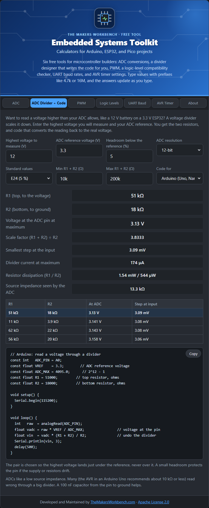

# Embedded Systems Toolkit

Free tools for Arduino, ESP32, and Raspberry Pi Pico builders, by [TheMakersWorkbench.com](https://www.themakersworkbench.com). One page, six tools, no build step and no dependencies. Type values with prefixes like `4.7k` or `16M`, and the answers update as you type.



## The tools

| Tab | What it does |
| --- | --- |
| ADC | Counts to volts and volts to counts for 8 to 16 bit converters, and the size of one step. |
| ADC Divider + Code | Finds resistors to measure a higher voltage with a 3.3 V or 5 V ADC, and writes Arduino, ESP32, or MicroPython code that scales the reading back. |
| PWM | Period, on and off time, average voltage, and a starting RC filter cutoff. |
| Logic Levels | Whether two chips can talk directly, need level shifting, or could be damaged. |
| UART Baud | The divisor and error for a clock and baud rate (AVR). |
| AVR Timer | Every prescaler and compare value that reaches a target frequency on the ATmega328P timers. |

## Run it

Open `index.html` in a browser. To serve it locally: `python -m http.server` in this folder.

Run the tests (Node 18 or newer, no packages needed):

```
node --test tests/embedded-logic.test.js
```

## Embed it

Load `emb.css`, `js/embedded-logic.js`, and `js/embedded-app.js`, then add:

```html
<div class="tmwb-emb" id="tmwb-emb" data-heading="h2"></div>
```

All styles are scoped under `.tmwb-emb` and sized in pixels.

### Drupal module

`drupal/tmwb_embedded_toolkit` is a Drupal 10/11 module (TMWB Embedded Toolkit) that embeds the tool from a text-format filter. See its README.

## Files

- `index.html`, `emb.css`: the page and styles
- `js/embedded-logic.js`: all the math and code generation, no DOM access, tested in Node
- `js/embedded-app.js`: the interface
- `tests/`: unit tests
- `drupal/tmwb_embedded_toolkit/`: Drupal module (run `python scripts/sync_drupal_module.py` after changing the tool)
- `SOURCES.md`: where each formula and data table comes from

## Accuracy

Formulas are the usual datasheet and textbook ones. The logic-level figures are typical datasheet values and differ between parts. The timer and UART tools follow the ATmega328P. Confirm anything that matters in the datasheet for your exact part.

## License

[Apache License 2.0](LICENSE). Free for commercial and non-commercial use. You may modify it and add to it, as long as the license, the [NOTICE](NOTICE), and the "Developed and Maintained by TheMakersWorkbench.com" attribution stay intact.
