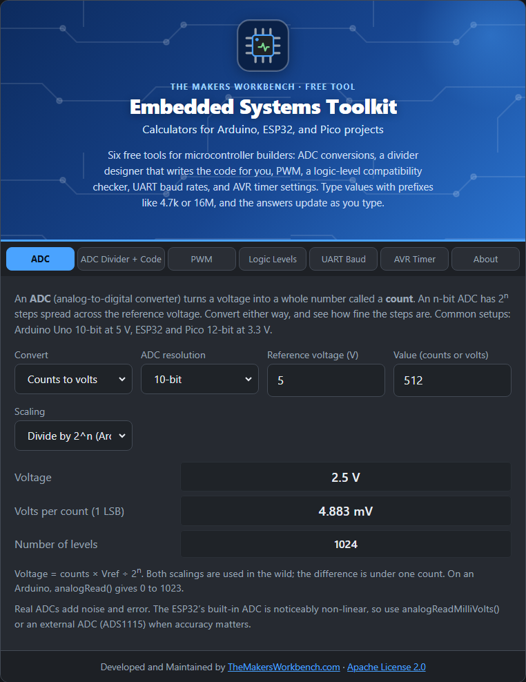

# ADC Calculator

An **ADC** (analog-to-digital converter) is the part of a microcontroller that measures a voltage. It cannot give you "2.31 volts" directly. It gives a whole number, called a **count**, and you convert that number back to a voltage.

## The theory

An n-bit ADC chops the range from 0 V up to its **reference voltage** (Vref) into 2^n equal steps:

- 8-bit: 256 steps
- 10-bit: 1,024 steps (Arduino Uno)
- 12-bit: 4,096 steps (ESP32, Raspberry Pi Pico)
- 16-bit: 65,536 steps (external converters like the ADS1115)

The size of one step (called **1 LSB**, "least significant bit") is **Vref ÷ 2^n**. A reading of N counts means a voltage of **N × Vref ÷ 2^n**. Going the other way, **counts = Vin ÷ Vref × 2^n**, rounded down.

You will see two conventions. Many chips and the Arduino use 2^n (counts 0 to 1023 span almost the full range). Others divide by 2^n − 1 so the top count is exactly Vref. The difference is under one count, and the tool lets you pick.

## Step by step

1. Open the **ADC** tab.
2. In **Convert**, choose **Counts to volts** (you have a reading) or **Volts to counts** (you know the voltage).
3. In **ADC resolution**, choose your converter's size, for example **10-bit** for an Arduino Uno.
4. In **Reference voltage (V)**, type Vref, for example `5` for an Uno on USB power or `3.3` for an ESP32.
5. In **Value**, type the counts (for example `512`) or the volts.
6. In **Scaling**, leave **Divide by 2^n (Arduino)** unless you know you need the other.
7. Read the result, plus **Volts per count (1 LSB)** and **Number of levels**.

## Worked example

An Arduino Uno reads `512` on an analog pin. With a 5 V reference and 10 bits, one step is 4.883 mV, so the voltage is 512 × 4.883 mV = **2.5 V**. For a 12-bit ESP32 at 3.3 V, one step is 0.806 mV.

## Things to watch

- The reading is only as good as the reference. On an Uno the default reference is the supply, which wobbles on USB power.
- ADCs have noise and error beyond the step size. A 12-bit converter is not accurate to 12 bits.
- The ESP32's built-in ADC is noticeably non-linear. Use `analogReadMilliVolts()` or an external ADC (such as the ADS1115) when accuracy matters.
- You cannot measure above Vref. To measure higher voltages, see [ADC Divider and Code](ADC-Divider-and-Code).

