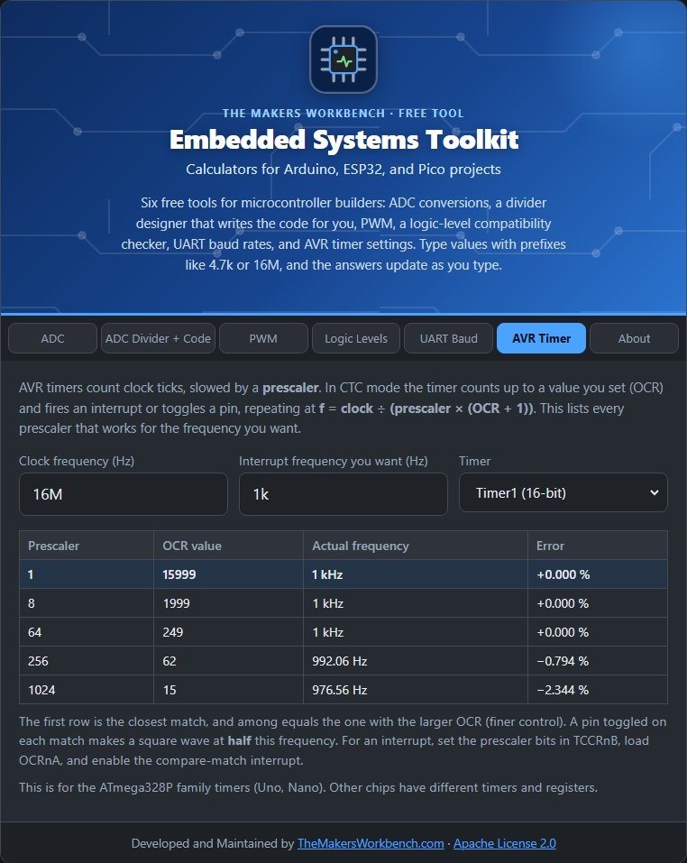

# AVR Timer and Prescaler

A **timer** is a counter inside the microcontroller that counts clock ticks on its own, without your code running. Timers make delays, regular interrupts, PWM, and precise frequencies.

## The theory

The chip's clock is too fast to count directly, so a **prescaler** divides it first (by 1, 8, 64, 256, or 1024 on most AVR timers). In **CTC mode** (clear timer on compare match), the timer counts up to a value you set, called **OCR**, then resets to zero and raises a flag or interrupt. That repeats at:

**frequency = clock ÷ (prescaler × (OCR + 1))**

Solving for the compare value: **OCR = clock ÷ (prescaler × frequency) − 1**.

Two limits apply:

- OCR has to be a whole number, so the real frequency is slightly off. A smaller prescaler gives a bigger OCR and finer control.
- OCR must fit in the timer: **0 to 255** for the 8-bit timers (Timer0, Timer2) and **0 to 65535** for the 16-bit Timer1.

## Step by step

1. Open the **AVR Timer** tab.
2. In **Clock frequency (Hz)**, type the chip clock, for example `16M`.
3. In **Interrupt frequency you want (Hz)**, type how often you want it to fire, for example `1k` for once per millisecond.
4. In **Timer**, choose **Timer1 (16-bit)** for the widest range, or an 8-bit timer if that is the one you are using.
5. Read the table. Each row is a prescaler that works, with the **OCR value**, the **Actual frequency**, and the **Error**. The first row is the closest.
6. In your code, set the prescaler bits in `TCCRnB`, load the OCR into `OCRnA`, set the CTC mode bit, and enable the compare-match interrupt.

## Worked example

A 1 kHz interrupt on a 16 MHz chip. On **Timer0 (8-bit)** only a prescaler of 64 fits, with **OCR = 249** and exactly 1,000.00 Hz. On **Timer1 (16-bit)** several prescalers work, such as 8 with OCR = 1999, and all are exact.

## Things to watch

- A pin set to **toggle** on each match makes a square wave at **half** the interrupt frequency.
- The Arduino core already uses Timer0 for `millis()` and `delay()`, and Timer1 for the Servo library and some PWM. Changing those timers breaks them. Timer2 is often free.
- This tab is for the **ATmega328P** (Uno, Nano). Other chips have different timers and registers.

