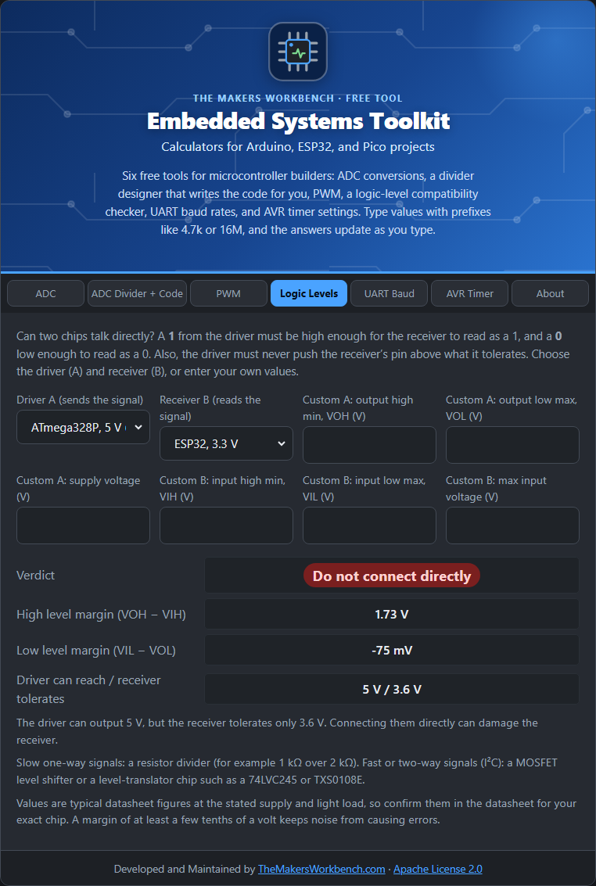

# Logic Level Checker

Digital chips agree that a voltage means 1 or 0, but they do not agree on **how high** a 1 must be. Connecting a 5 V device to a 3.3 V device can fail in two ways: the signal is misread, or a pin is damaged.

## The theory

Each digital pin has four numbers on its datasheet:

- **VOH**: the lowest voltage the pin outputs when it is driving a **1** (output high).
- **VOL**: the highest voltage the pin outputs when driving a **0** (output low).
- **VIH**: the lowest voltage the pin will **read as a 1** (input high).
- **VIL**: the highest voltage the pin will **read as a 0** (input low).

For driver A to talk to receiver B:

- **High margin = VOH(A) − VIH(B)** must be positive. A's 1 has to be high enough for B.
- **Low margin = VIL(B) − VOL(A)** must be positive. A's 0 has to be low enough for B.
- A's highest output (its supply) must not exceed B's **maximum input voltage**, or B can be damaged.

Margins of a few tenths of a volt or more keep electrical noise from flipping bits.

## Step by step

1. Open the **Logic Levels** tab.
2. In **Driver A**, choose the device that **sends** the signal, for example **ATmega328P, 5 V (Uno)**.
3. In **Receiver B**, choose the device that **reads** it, for example **ESP32, 3.3 V**.
4. If your part is not in the list, choose **Custom values** in either box and fill in the matching **Custom** fields (the datasheet figures).
5. Read the **Verdict**, the two margins, and the advice below.
6. Run it both ways. For a two-way link (like I²C or serial TX/RX), check A to B and B to A.

## What the verdicts mean

- **Compatible**: connect directly.
- **Marginal**: it should work, but keep wires short and consider a shifter for anything critical.
- **Level shifting needed**: one level is misread. Use a level shifter, or a buffer powered from the receiver's supply (for example a 74HCT buffer lets 3.3 V signals drive 5 V logic).
- **Do not connect directly**: the driver can output more than the receiver tolerates. Use a resistor divider (slow, one-way signals), a MOSFET shifter (I²C and other two-way lines), or a translator chip.

## Worked examples

- **Uno (5 V) to ESP32 (3.3 V)**: do not connect directly. The Uno can output 5 V, but the ESP32 tolerates about 3.6 V.
- **ESP32 to Uno**: level shifting needed. The ESP32's 2.64 V high is below the 3.0 V the Uno needs to read a 1.
- **ESP32 to a 74HCT chip at 5 V**: compatible, because 74HCT inputs accept 2.0 V as a 1.

## Things to watch

- The values are typical datasheet figures. Check your exact part, especially at a different supply voltage.
- Many boards add parts (level shifters, resistors) that change the story. A 5 V sensor module with a 3.3 V output is not the same as the bare chip.
- Open-drain buses like I²C have different rules: the pull-up voltage decides the high level.

