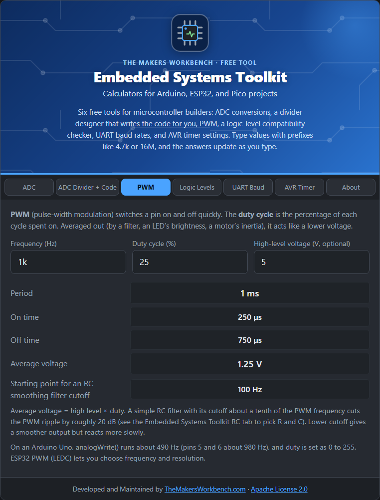

# PWM Calculator

**PWM** (pulse-width modulation) is how a digital pin fakes an analog output. The pin switches fully on and fully off, very quickly, and the **duty cycle** (the percentage of each cycle spent on) sets the average.

## The theory

- **Period** = 1 ÷ frequency. At 1 kHz, each cycle lasts 1 ms.
- **On time** = duty × period. At 25 % duty, the pin is on for 250 µs of each 1 ms.
- **Average voltage** = high-level voltage × duty. A 5 V pin at 25 % averages 1.25 V.

An LED looks dimmer because your eye averages the flashes. A motor speeds or slows because it cannot respond to every pulse. To get a real smoothed voltage, put an **RC low-pass filter** after the pin. A filter cutoff about one tenth of the PWM frequency cuts the ripple by roughly 20 dB (see [RC Filter](https://github.com/MakersWorkbench/circuit-calculators/wiki/RC-Filter) to pick R and C).

## Step by step

1. Open the **PWM** tab.
2. In **Frequency (Hz)**, type the PWM frequency, for example `1k`.
3. In **Duty cycle (%)**, type how long the pin is on, from `0` to `100`.
4. In **High-level voltage (V, optional)**, type the pin's voltage, for example `5` or `3.3`.
5. Read **Period**, **On time**, **Off time**, **Average voltage**, and the starting RC cutoff.

## Worked example

1 kHz at 25 % on a 5 V pin: period **1 ms**, on **250 µs**, off **750 µs**, average **1.25 V**. For a smoothed analog voltage, start with an RC cutoff near **100 Hz**.

## Things to watch

- An Arduino Uno's `analogWrite()` is about 490 Hz (pins 5 and 6 about 980 Hz), with duty set as 0 to 255.
- ESP32 PWM (LEDC) lets you pick both frequency and resolution.
- Motors and LEDs want different frequencies: motors usually 1 to 20 kHz (above hearing), LED dimming at least a few hundred hertz to avoid visible flicker.
- A pin cannot drive a big load directly. Use a transistor or MOSFET (see the [Circuit Calculators wiki](https://github.com/MakersWorkbench/circuit-calculators/wiki)).

