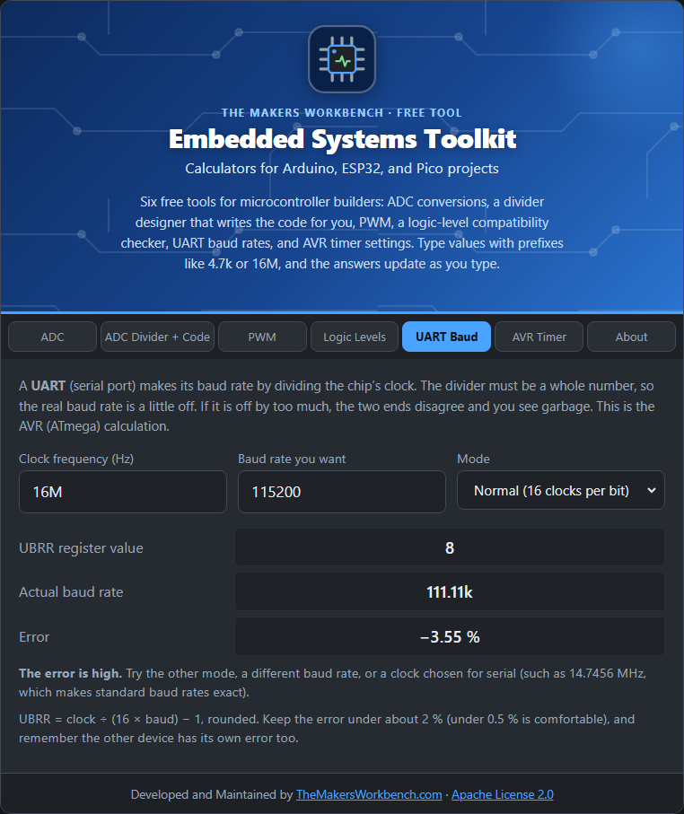

# UART Baud Rate

A **UART** is the serial port a microcontroller uses for `Serial.print`, GPS modules, and USB-to-serial chips. Both ends must agree on the **baud rate** (bits per second). The chip makes its baud rate by dividing its clock, and the divider has to be a whole number, so the real rate is usually slightly off.

## The theory

On an AVR (ATmega) the divider lives in a register called **UBRR**. In normal mode each bit lasts 16 clock-divisions:

**UBRR = clock ÷ (16 × baud) − 1**, rounded to a whole number.

The real baud rate is **clock ÷ (16 × (UBRR + 1))**. The **error** is how far that is from the target. Double-speed mode (the **U2X** bit) uses 8 divisions per bit, which suits fast rates on slow clocks.

If the error is too big, the receiver samples the bits at the wrong time and you see garbage. Keep it **under about 2 %**, and under 0.5 % is comfortable (the other device has its own error too).

## Step by step

1. Open the **UART Baud** tab.
2. In **Clock frequency (Hz)**, type the chip's clock, for example `16M`.
3. In **Baud rate you want**, type it, for example `115200`.
4. In **Mode**, choose **Normal** or **Double speed, U2X**.
5. Read **UBRR register value**, **Actual baud rate**, and **Error**.
6. If the error is high, try the other mode, a different baud rate, or a different clock.

## Worked examples

- **16 MHz, 9600 baud**: UBRR = 103, actual 9615, error **+0.16 %**. Fine.
- **16 MHz, 115200 baud, normal mode**: UBRR = 8, actual 111,111, error **−3.5 %**. Too high.
- **Same, double-speed mode**: UBRR = 16, actual 117,647, error **+2.1 %**. Borderline.

A 14.7456 MHz crystal makes standard rates exact, which is why you see that odd value in serial gear.

## Things to watch

- This is the **AVR** calculation (Uno, Nano, Mega, ATtiny with a USART). ESP32, RP2040, and STM32 use fractional dividers and are far more accurate, so they rarely need this.
- Match the other settings too: data bits, parity, and stop bits (usually 8N1).
- Long wires and noisy environments cut the usable baud rate.

